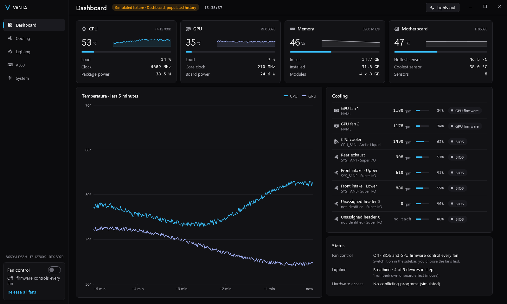
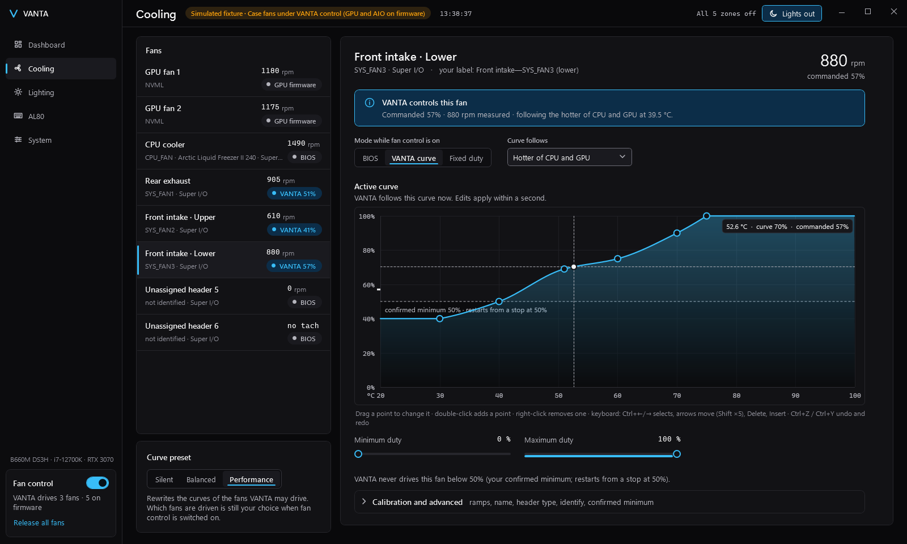
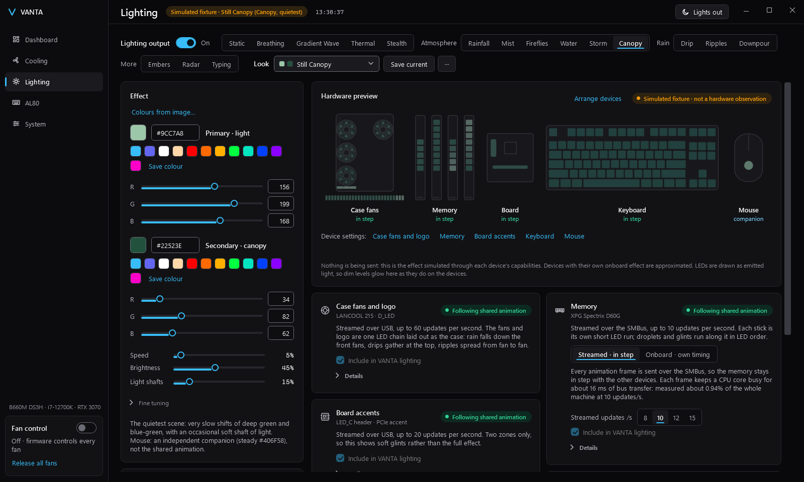
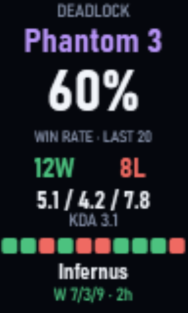

# VANTA

Fan, lighting and screen control for one Gigabyte + XPG PC, without the vendor apps. Windows, WPF, .NET 8.

**Built for my PC.** It talks straight to a Super I/O chip, SMBus RGB controllers and USB devices, and every device table in it is for the hardware listed below. On anything else it will not work, and it should not be pointed at other hardware without reading [docs/SAFETY.md](docs/SAFETY.md) first.



The screenshots come from VANTA's simulated-fixture mode, so the numbers are made up. The yellow tag in each header says so.

## What it does

| Area | What you get |
| --- | --- |
| Fans | Per-fan curves for the case fan headers (IT8689E), the AIO pump and both GPU fans (NVML). Each fan has a minimum duty measured with a stall test. Every fan goes back to firmware control on exit, on sleep and after a crash. |
| Lighting | One effect engine for the case fans and logo, memory, board LEDs, keyboard and mouse. Classic effects plus scenes: rainfall, fog, fireflies, storm, canopy, drip, ripples, downpour, embers, radar and typing ripples. Saved looks, a revert button, and a Lights out hotkey (Ctrl+Shift+F12). |
| YUNZII AL80 | Per-key lighting on the stock firmware, and its 96 x 160 screen: live system stats, Spotify now playing, stored GIFs. |
| Glorious Model O Wireless | Colour, stored on the mouse or streamed live. |
| App | Dashboard, cooling and lighting pages, tray menu, three themes (Vanta, Obsidian, Porcelain). |





## Deadlock profile (new, experimental)

When `deadlock.exe` runs, the lights go to full brightness and the AL80 screen shows your rank, win rate over the last 20 scored matches, average K/D/A and the last match. Everything goes back when the game closes. Stats come from the [Deadlock API](https://deadlock-api.com), the data Statlocker is built on, so numbers can differ a little from statlocker.gg. The only personal value sent is your Steam account number, and only while the game runs.



This one is tested against a simulated keyboard and fake HTTP answers only. It has not run on the real keyboard or with a real account yet.

## Hardware it was built on

| Part | Model |
| --- | --- |
| Board | Gigabyte B660M DS3H DDR4 (BIOS F21), ITE IT8689E Super I/O |
| CPU / GPU | i7-12700K, RTX 3070 Founders Edition |
| Memory | 4 x 8 GB XPG Spectrix D60G DDR4-3200 (ENE RGB controllers on SMBus) |
| Cooling | Arctic Liquid Freezer II 240, LANCOOL 215 with its ARGB hub on the board's D_LED header (IT5701) |
| Keyboard / mouse | YUNZII AL80, Glorious Model O Wireless |

## Build and run

You need Windows 11, the .NET 8 SDK, and [PawnIO](https://pawnio.eu) installed (LibreHardwareMonitor uses it for the motherboard sensors and SMBus). VANTA runs elevated.

```
cd src/HwSuite
dotnet build -c Release
```

Run the checks. This never touches hardware:

```
dotnet bin/Release/net8.0-windows10.0.19041.0/win-x64/HwSuite.dll --selftest --no-hardware
```

The last run passed 1,052 checks. To render the screenshots above from simulated state:

```
dotnet bin/Release/net8.0-windows10.0.19041.0/win-x64/HwSuite.dll --ui-fixtures shots --theme vanta
```

`Install-Vanta.ps1` installs a published build to `C:\Program Files\VANTA`, keeps one rollback copy and checks every file's hash. Its header explains each step. `Uninstall-Vanta.ps1` removes only the files it installed.

## Status

I have run it on my own PC since mid-October 2026. Fan control, the lighting engine, the AL80 and the mouse all work there. The Deadlock profile and the Linux port have not run on real hardware.

- Windows only. `linux/` holds an in-progress Fedora port: the engine builds and passes most of the shared self-tests, but it has no UI.
- The first 8 pictures sent to an AL80 after a clear go to its flash, and later ones stay in RAM. VANTA sends screen pictures only after you confirm in the app that the 8 slots are full.
- Mouse lighting is limited by the mouse. See [docs/mouse-sync/RESULTS.md](docs/mouse-sync/RESULTS.md) for what was measured.

## Read next

- [docs/SAFETY.md](docs/SAFETY.md): what VANTA writes, what it never writes, and how it hands things back.
- [docs/gpu-zero-rpm/REPORT.md](docs/gpu-zero-rpm/REPORT.md): what the RTX 3070's zero-RPM mode does and what NVML can and cannot change.
- `src/HwSuite/`: the app. `src/HwSuite/Hardware/`: device code. `src/HwSuite/Cli/`: self-tests and one-shot commands.

## Credits

Built on [LibreHardwareMonitor](https://github.com/LibreHardwareMonitor/LibreHardwareMonitor) (MPL-2.0), HidSharp (Apache-2.0) and PawnIO. The AL80 protocol comes from [snackdriven/al80-lcd](https://github.com/snackdriven/al80-lcd), [techno1731/yunzii-al80-unlocked](https://github.com/techno1731/yunzii-al80-unlocked) (MIT) and my own captures in [yunzii](https://github.com/jonathantrapp/yunzii). Not affiliated with Gigabyte, XPG, YUNZII, Glorious or Valve.

MIT license.
